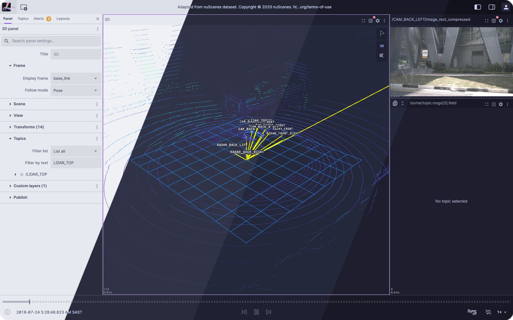
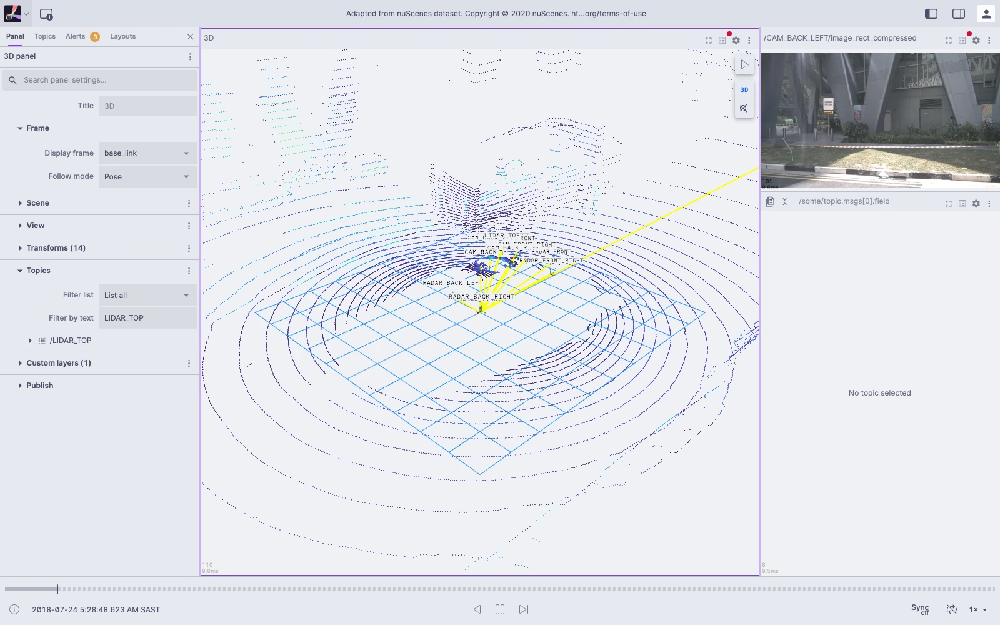
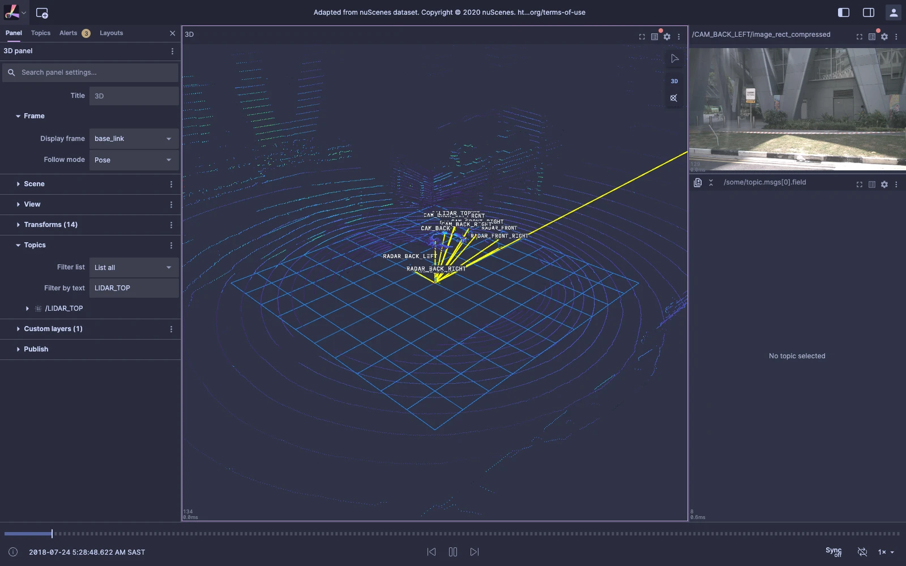
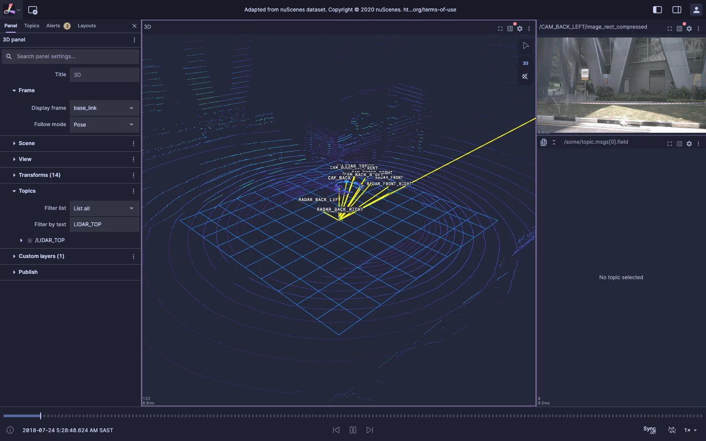
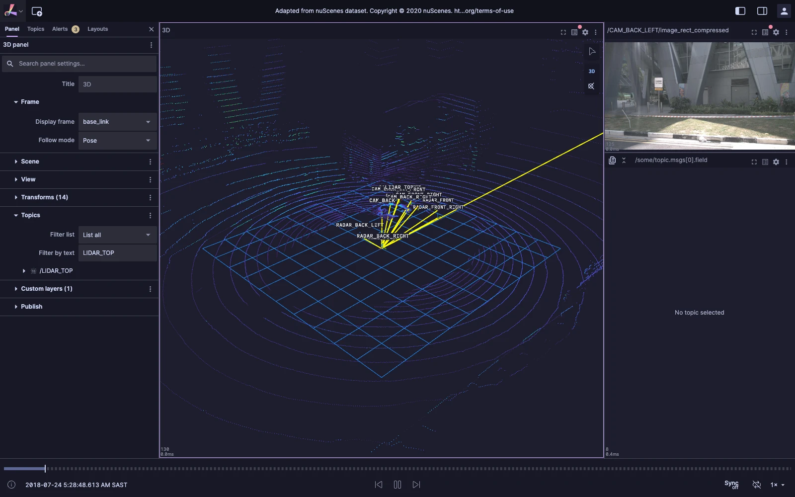

<h3 align="center">
	<br/>
	
	Catppuccin for <a href="https://github.com/lichtblick-suite/lichtblick">Lichtblick</a>
	
</h3>

<p align="center">
	<a href="https://github.com/smldr/lichtblick/stargazers"></a>
	<a href="https://github.com/smldr/lichtblick/issues"></a>
	<a href="https://github.com/smldr/lichtblick/contributors"></a>
</p>

<p align="center">
	
</p>

> [!NOTE]
> This is an **unofficial** build of [Lichtblick](https://github.com/lichtblick-suite/lichtblick),
> the robotics visualization and diagnosis tool. It is not affiliated with or endorsed by the
> Lichtblick project or BMW. Report bugs in the theme here, not upstream.

## Previews

<details>
<summary>🌻 Latte</summary>

</details>
<details>
<summary>🪴 Frappé</summary>

</details>
<details>
<summary>🌺 Macchiato</summary>

</details>
<details>
<summary>🌿 Mocha</summary>

</details>

## Usage

1. Download the build for your platform from [Releases](https://github.com/smldr/lichtblick/releases),
   or build it yourself (below).
2. Open **Settings** (user menu, top right) > **General**.
3. Pick a **Flavor** (Latte, Frappé, Macchiato, Mocha, or System) and an **Accent**.

With **System**, Lichtblick uses Latte when your OS is light and the dark flavor of your choice
when it is dark. All four flavors and all 14 accents are supported.

### Building from source

```bash
corepack enable
yarn install
yarn web:serve        # web version at http://localhost:8080
yarn desktop:serve    # desktop: run this, then `yarn desktop:start` in a second terminal
```

## 🙋 FAQ

- Q: **_"Does this change anything besides colors?"_**\
  A: No. It tracks upstream Lichtblick; only the theme, the settings picker and branding differ.
- Q: **_"Where does the theme code live?"_**\
  A: `packages/theme/src/catppuccin/` (palettes, built from
  [`@catppuccin/palette`](https://github.com/catppuccin/palette)) and
  `packages/suite-base/src/components/Catppuccin/` (settings UI).
- Q: **_"My 3D panel background isn't themed."_**\
  A: A background color set in the panel's own settings overrides the flavor. Clear it to
  use the flavor's Base color.

## 💝 Thanks to

- [smldr](https://github.com/smldr)
- The [Lichtblick](https://github.com/lichtblick-suite/lichtblick) team, for the app itself

The original Lichtblick README is kept at [docs/UPSTREAM_README.md](docs/UPSTREAM_README.md).

&nbsp;

<p align="center">
	
</p>

<p align="center">
	Copyright &copy; 2021-present <a href="https://github.com/catppuccin" target="_blank">Catppuccin Org</a>
</p>

<p align="center">
	<a href="LICENSE"></a>
</p>
